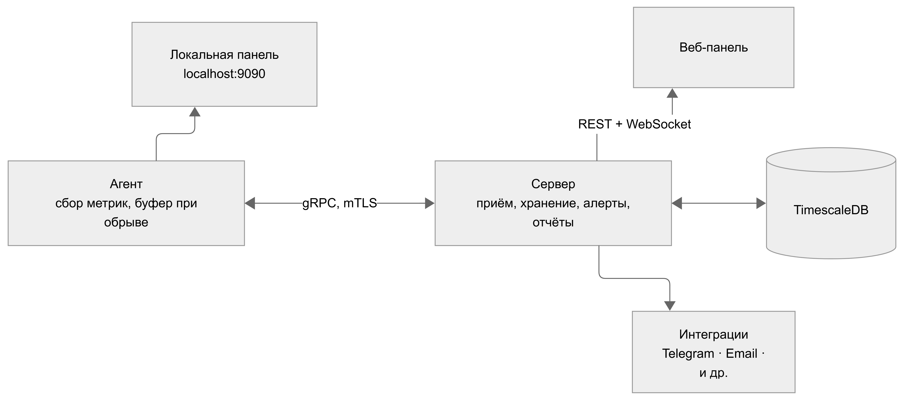

# Vigil

Vigil — self-hosted система мониторинга рабочих и серверных компьютеров в реальном времени

Лёгкий Go-агент разворачивается на любом Windows или Linux ПК одним исполняемым файлом без зависимостей. Метрики передаются на сервер по gRPC, хранятся в TimescaleDB и мгновенно отображаются в браузере через WebSocket. Администратор видит нагрузку, активность на машинах и события по всему парку в реальном времени — с группировкой агентов, гибкими алертами, отчётами и анализом аномалий.

Стек: Go · React · gRPC · TimescaleDB · Protobuf · WebSocket

## Основной функционал

- системные метрики - CPU, RAM, диски, сеть, GPU, температуры. Разрешение до 0,5–1 с, настраивается индивидуально для каждого агента;
- процессы - полные списки, топ по нагрузке, история появления и завершения;
- активность на машине - активное приложение, сессии активности, время простоя (режим рабочей станции);
- наблюдение - скриншот по запросу, трансляция экрана с индикатором на агенте и журналом просмотров;
- мониторинг сервисов - статус процессов и портов, healthcheck, системные события, Docker-контейнеры (режим сервера);
- инвентарь оборудования - комплектующие, ОС, серийные номера;
- группы агентов - объединение машин в группы, права пользователей в пределах групп;
- аутентификация и разграничение прав - администратор и наблюдатель с областью действия по группам;
- аналитика - графики истории, сравнение агентов и периодов, статистический и ML-анализ аномалий;
- алерты - правила с порогами, длительностью и расписанием, уведомления во внешние сервисы;
- отчёты - по агенту, группе или всему парку за период, экспорт, рассылка по расписанию;
- файлы - просмотр разрешённых директорий на агенте;

## Архитектура

Основные компоненты:

__Агент__ - легкий исполняемый файл под Windows и Linux. Собирает метрики, отправляет по gRPC-каналу серверу. Работает в режиме рабочей станции или сервера;

__Сервер__ - принимает данные от агентов, пишет в TimescaleDB, отправляет панели данные по REST и WebSocket, рассылает команды агентам и уведомления во внешние сервисы.  

__Веб-панель__ - обзор подключенных агентов и групп, их детальные страницы, отчёты, уведомления, настройки.  

__Локальная панель агента__ - встроена в агента, доступна на localhost:8111. Показывает метрики своего ПК, процессы, файлы и настройки подключения.  

